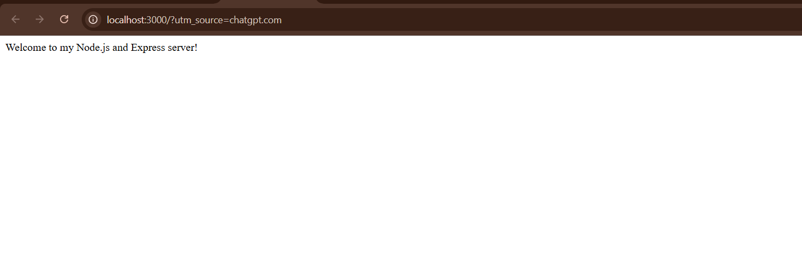
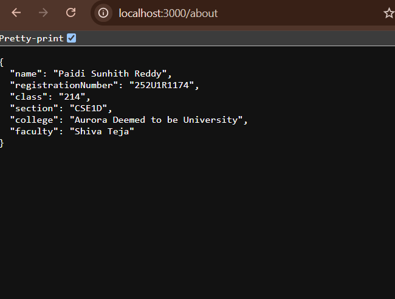
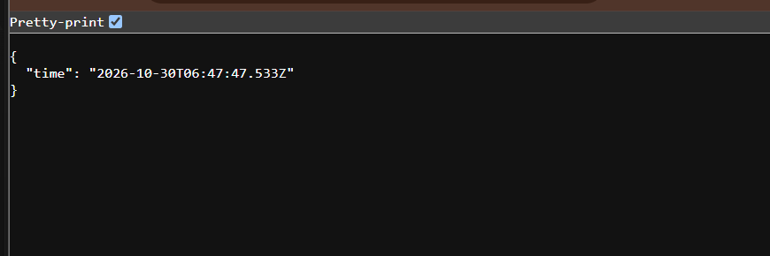
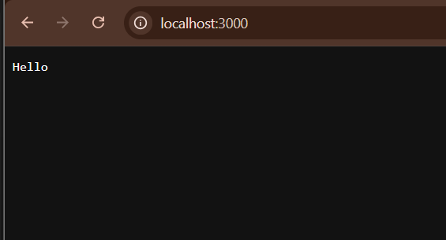

# Lab 1 — Node.js and Express Server

## Deployment

**Deployment URL:** [https://lab-01-uo69.vercel.app](https://lab-01-uo69.vercel.app)

All four endpoints were manually tested successfully:

- [Home endpoint](https://lab-01-uo69.vercel.app/)
- [About endpoint](https://lab-01-uo69.vercel.app/about)
- [Time endpoint](https://lab-01-uo69.vercel.app/time)
- [Unknown route (expected 404)](https://lab-01-uo69.vercel.app/unknown)

## Student information

| Field | Details |
| --- | --- |
| Student name | Paidi Sunhith Reddy |
| Registration number | 252U1R1174 |
| Class | 214 |
| Section | CSE1D |
| College | Aurora Deemed to be University |
| Course | Backend Development Fundamentals |
| Academic year | II |
| Branch | CSE |
| Faculty | Siva  sai Teja |
| GitHub username | [paidisunhithreddy8-arch](https://github.com/paidisunhithreddy8-arch) |

## Objective

Create a plain HTTP server using Node.js's built-in `http` module and a second server using Express.js. Implement routes that return a welcome message, student information, the current time, and a not-found response. Learn to run and test both servers.

## Introduction

### Node.js

Node.js is a JavaScript runtime that runs JavaScript outside a web browser. It includes built-in modules, such as `http`, that can be used to create servers and other backend programs.

### Express.js

Express.js is a web framework for Node.js. It provides convenient ways to define URL routes and send text or JSON responses, so common server tasks require less low-level code.

## Project structure

```text
lab-01/
├── .gitignore
├── README.md
├── SUBMISSION-CHECKLIST.md
├── http-server.js
├── package.json
├── package-lock.json
├── server.js
├── test/
│   └── server.test.js
└── screenshots/
    ├── about.png
    ├── home.png
    ├── http-server.png
    ├── not-found.png
    └── time.png
```

`node_modules/` is created by npm during installation and is ignored by Git.

## Prerequisites

- Node.js 18 or later (the tests use Node's built-in `fetch` API)
- npm, included with Node.js
- A terminal and web browser

## Installation

Open a terminal in the `lab-01` folder and install the dependency:

```powershell
npm install
```

In Windows PowerShell, if the `npm` script wrapper is blocked by execution policy, use `npm.cmd` instead:

```powershell
npm.cmd install
```

## Run the Express server

```powershell
npm start
```

If needed in PowerShell:

```powershell
npm.cmd start
```

The server listens on `http://localhost:3000` by default. Leave the terminal open while using it. Press `Ctrl+C` in that terminal to stop it.

## Run the plain Node.js HTTP server

Stop the Express server first, then run:

```powershell
npm run start:http
```

If needed in PowerShell:

```powershell
npm.cmd run start:http
```

This server also defaults to port 3000, so the two servers cannot listen on that same port at the same time. It returns exactly `Hello` at `/`.

## package.json and node_modules

`package.json` is the project manifest. It lists the project name, version, description, author, Express dependency, and npm scripts. `package-lock.json` records the resolved dependency versions so installs can be reproduced.

`node_modules/` contains the packages downloaded by npm. It is generated by `npm install` and excluded from Git by `.gitignore`; it should not be committed.

### Available npm scripts

| Command | Purpose |
| --- | --- |
| `npm start` | Start the Express server (`server.js`) |
| `npm run start:http` | Start the plain Node.js HTTP server (`http-server.js`) |
| `npm test` | Run the automated tests with Node's built-in test runner |

## API endpoints

| Method | Endpoint | Description | Status |
| --- | --- | --- | --- |
| GET | / | Welcome message | 200 |
| GET | /about | Student details in JSON | 200 |
| GET | /time | Current date and time | 200 |
| GET | /unknown | Not found message (all unknown routes) | 404 |

The Express `/time` response contains an ISO 8601 timestamp generated with `new Date().toISOString()`. The Express not-found response body is `404 - Page Not Found`. The plain HTTP server responds with status 200 and body `Hello` for `GET /`; unknown paths return status 404.

### Local URLs

With the Express server running, open:

- <http://localhost:3000/>
- <http://localhost:3000/about>
- <http://localhost:3000/time>
- <http://localhost:3000/unknown>

For the plain HTTP server, stop Express, start the HTTP server, and open <http://localhost:3000/>.

## HTTP status codes

- **200 OK:** The request succeeded. The home, about, and time routes return this status.
- **404 Not Found:** The requested route does not exist. The fallback handler returns this status for unknown routes.

## Screenshots

### Home Endpoint



### About Endpoint



### Time Endpoint



### 404 Not Found


### Plain Node.js HTTP Server



## Testing

The project uses Node.js's built-in test runner. The six tests cover the four Express routes and both required plain HTTP cases. They start servers on temporary ports and close them after testing.

Command:

```powershell
npm test
```

The tests were run in this project: **6 passed, 0 failed**.

## Problems faced and solutions

In this PowerShell environment, invoking `npm` was blocked by the script execution policy. Using `npm.cmd` worked. No server-code or test errors needed fixing. The tests use temporary ports to avoid clashes with other services.

## GitHub repository information

- **GitHub username:** `paidisunhithreddy8-arch`
- **Profile:** <https://github.com/paidisunhithreddy8-arch>
- **Repository:** [LAB-1](https://github.com/paidisunhithreddy8-arch/LAB-1) (public)
- **Lab 1 folder:** [lab-01](https://github.com/paidisunhithreddy8-arch/LAB-1/tree/main/lab-01)
- **Branch:** `main`
- **Submitted commit:** `3e67f551f88ec37b61b3d16dfac3b0187829006e`

The project has been pushed to the verified public repository. To review future changes and publish updates from the repository root, use:

```powershell
git status
git add lab-01/
git commit -m "Update Backend Development Fundamentals Lab 1"
git push origin main
```
## Vercel deployment

This project is deployed at [https://lab-01-uo69.vercel.app](https://lab-01-uo69.vercel.app). The Vercel project Root Directory is `lab-01`, where this project's `package.json` is located. The four deployed endpoints listed above were manually tested successfully.
## Viva questions and answers

1. **What is Node.js?** A runtime that lets JavaScript run outside a browser, including on a server.
2. **What is Express.js?** A Node.js framework that makes it easier to create servers and handle routes.
3. **What is `package.json`?** The project file that lists metadata, dependencies, and npm commands.
4. **What is `node_modules`?** The folder where npm stores installed packages.
5. **What does `app.listen()` do?** It starts the Express app listening for requests on a port.
6. **What are `req` and `res`?** `req` contains the incoming request; `res` is used to send a response.
7. **What is an API endpoint?** A route a client can request, such as `GET /about`.
8. **What does HTTP 200 mean?** The request succeeded.
9. **What does HTTP 404 mean?** The requested route or resource was not found.
10. **What does `http.createServer()` do?** It creates a server using Node's built-in HTTP module and a request handler.
11. **What does `npm install` do?** It installs the project's declared dependencies.
12. **Why use `process.env.PORT`?** A hosting provider can choose the port, and the app reads the assigned value from the environment.
13. **How do Node HTTP and Express differ?** Node's HTTP module provides basic server tools; Express adds convenient routing and response helpers.
14. **What is a GET request?** A request asking the server to return a resource or data.
15. **What is JSON?** A text format for structured data made from objects, arrays, and values.

## Final submission checklist

- [x] Plain Node.js HTTP server created.
- [x] Express server and required routes created.
- [x] Automated tests passed (6 passed, 0 failed).
- [x] Student information included.
- [x] README and all five genuine screenshots included.
- [x] `.gitignore` configured; `node_modules/` is excluded.
- [x] GitHub repository created and verified.
- [x] Project committed and pushed to the verified repository.
- [x] Repository is public and accessible.
- [x] Vercel deployment completed and all four endpoints manually verified.
- [x] Verified Vercel deployment URL added near the top of this README.
- [ ] GitHub form submitted: <https://docs.google.com/forms/d/e/1FAIpQLSd4eOVMM_PQQs2I9AWT9PCUF1o9l3G3wypCbeKJOHx87z0fnQ/viewform>
- [ ] Repository link added to the lab report.
- [ ] Lab report submitted through ERP.
