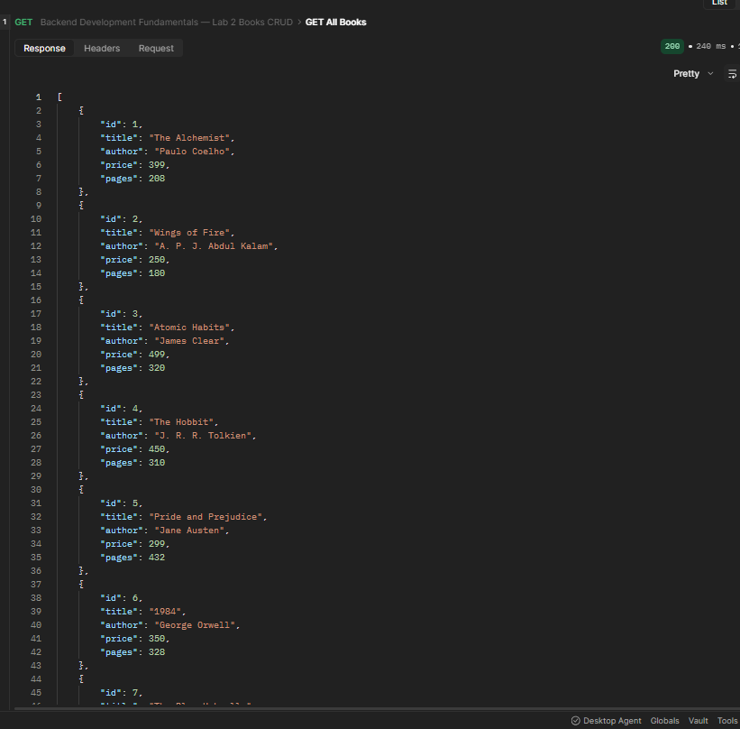
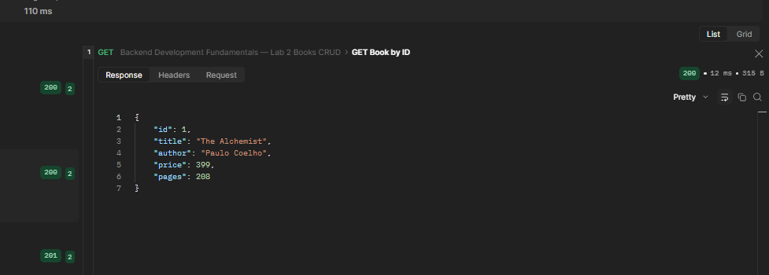
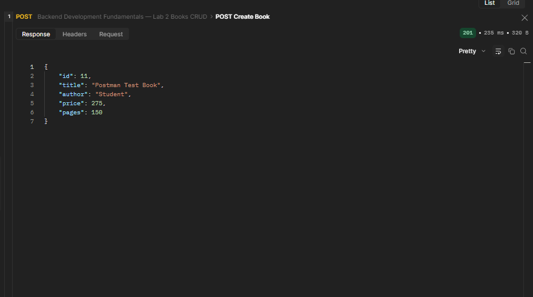
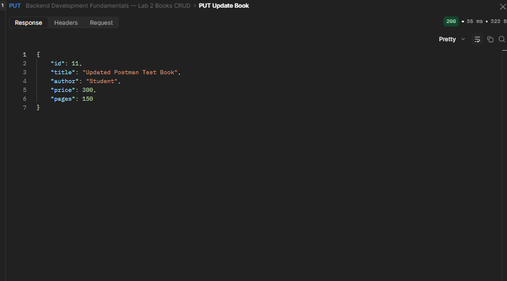
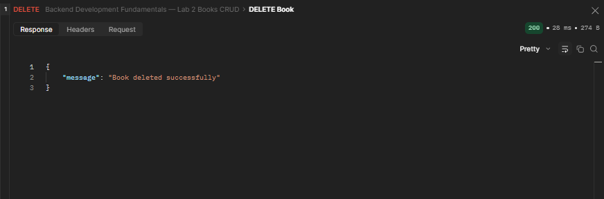
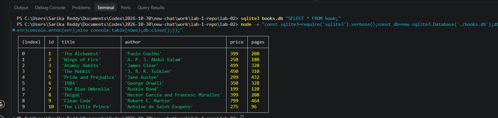

# Lab 2 — SQLite Database and CRUD Routes

> The original lab used SQLite. The hosted application has now been migrated to PostgreSQL so it can use a free managed database rather than local disk storage. The five endpoint paths and response formats are retained.

## Student details

| Field | Details |
| --- | --- |
| Name | Paidi Sunhith Reddy |
| Registration number | 252U1R1174 |
| Class | 214 |
| Section | CSE1D |
| College | Aurora Deemed to be University |
| Course | Backend Development Fundamentals |

## Deployment
## Live Deployment

https://lab-02-5ug9.onrender.com

**Status:** Successfully deployed on Render.

**Live API:** https://lab-02-5ug9.onrender.com

**Database:** PostgreSQL, connected using the `DATABASE_URL` environment variable.

## What this lab teaches

Express receives HTTP requests and PostgreSQL stores the books in a managed database. Database operations are asynchronous. User supplied values are sent as bound PostgreSQL parameters (`$1`, `$2`, and so on), separate from SQL instructions.

## Project structure

```text
lab-02/
├── .env.example
├── .gitignore
├── README.md
├── books.db                 # retained SQLite file from the original lab; not used by the migrated server
├── books.sql                # retained SQLite setup script; not used by the migrated server
├── package.json
├── package-lock.json
├── Postman-Lab-2-Collection.json
├── render.yaml
├── server.js                # Express API, PostgreSQL setup and sample seeding
├── screenshots/             # existing evidence; see note below
└── test/
    └── books.test.js        # CRUD and seeding tests using pg-mem
```

`node_modules/` is installed locally and ignored by Git. `.env` is ignored too. `.env.example` contains a blank `DATABASE_URL` setting; it does not contain a real database credential. The old SQLite database and SQL file are retained for reference and are no longer read or written by the application.

## Requirements and installation

Install Node.js 20.17+ and npm. Express provides the HTTP routes, `pg` connects to PostgreSQL, nodemon restarts the local server after code changes, and `pg-mem` plus Supertest support automated tests without connecting to a real Neon project.

In PowerShell, open a terminal in this `lab-02/` folder and run:

```powershell
npm.cmd install
npm.cmd test
```

## Database setup

The application connects using the `DATABASE_URL` environment variable. Create a free PostgreSQL project in Neon and copy its pooled connection string from the Neon dashboard. Keep the connection string private; do not paste it into source code or commit it.

For local development in PowerShell, set the variable in the terminal before starting the app. Substitute the connection string copied from your Neon dashboard:

```powershell
$env:DATABASE_URL = "<your Neon PostgreSQL connection string>"
```

The server creates the PostgreSQL `book` table when it starts. Its columns are `id` (generated primary key), `title`, `author`, `price`, and `pages`. Startup inserts the ten sample books inside a transaction only when the table is empty. Repeated starts leave existing records as they are.

## Run the server

After setting `DATABASE_URL`, run nodemon:

```powershell
npm.cmd run dev
```

The API listens at `http://localhost:3001`. Keep the terminal open while testing. Press `Ctrl+C` to stop it. For a normal start without watching files, run `npm.cmd start`.

`initializeDBAndServer()` checks that `DATABASE_URL` is present, connects to PostgreSQL, creates the table and seeds it if empty. Express starts only after those database steps succeed. If the connection or initialization fails, the server does not start.

## API endpoints

All request and response bodies are JSON. For POST and PUT, send `title` and `author` as non-empty strings, `price` as a non-negative integer, and `pages` as a positive integer.

| Method | Path | Description | Success status |
| --- | --- | --- | --- |
| GET | `/books/` | Return all books | 200 |
| GET | `/books/:bookId/` | Return one book by ID | 200 |
| POST | `/books/` | Create a book | 201 |
| PUT | `/books/:bookId/` | Replace a book's editable fields | 200 |
| DELETE | `/books/:bookId/` | Delete a book | 200 |

Examples: `GET http://localhost:3001/books/` and `GET http://localhost:3001/books/1/`.

### Status codes

- `200 OK`: a read, update, or delete succeeded.
- `201 Created`: a book was added.
- `400 Bad Request`: an ID or request body is invalid.
- `404 Not Found`: the requested book ID does not exist.
- `500 Internal Server Error`: an unexpected server/database request error occurred.

Every SQL statement that uses request values binds them with PostgreSQL parameters. Request data is never concatenated into SQL text.

## Automated verification

Run the automated tests with:

```powershell
npm.cmd test
```

Tests use `pg-mem`, an in-memory PostgreSQL-compatible test database. They exercise all five routes, invalid IDs and input, missing records, parameter binding, automatic seeding, repeat initialization, and error responses. Tests do not require a Neon URL and do not replace manual verification against the deployed database or the assignment's Postman evidence.

The importable collection is [`Postman-Lab-2-Collection.json`](Postman-Lab-2-Collection.json). It contains the five CRUD requests in order and saves the returned POST ID as `bookId` for PUT and DELETE. For local testing, set the collection's request URLs to `http://localhost:3001` and use Postman's Desktop Agent (a cloud agent cannot reach your computer's localhost). For deployed testing, change the base URL to the actual Render service URL after deployment.

### Capture genuine screenshots

Capture each screenshot only after its real request and response are visible. Keep the request method, URL, response status, response body, and Postman test result in view. Use Windows Snipping Tool (`Win+Shift+S`) or another real screen capture tool and save unaltered captures in `lab-02/screenshots/`.

The existing screenshot references below are preserved from the original SQLite version. They are historical evidence and do not prove that the migrated PostgreSQL application or a Render deployment has been tested. After migration, recapture the CRUD endpoint screenshots against the local app or deployed app. For the database evidence, use the Neon SQL Editor to run `SELECT id, title, author, price, pages FROM book ORDER BY id;` and capture the actual results.

## Screenshots / Evidence

### GET All Books

Existing capture (from the original SQLite implementation; replace with a genuine capture of the migrated API before submission).



### GET Book by ID

Existing capture (from the original SQLite implementation; replace with a genuine capture of the migrated API before submission).



### POST Create Book

Existing capture (from the original SQLite implementation; replace with a genuine capture of the migrated API before submission).



### PUT Update Book

Existing capture (from the original SQLite implementation; replace with a genuine capture of the migrated API before submission).



### DELETE Book

Existing capture (from the original SQLite implementation; replace with a genuine capture of the migrated API before submission).



### Database Records

Existing SQLite CLI capture from the original implementation. It is not evidence of Neon PostgreSQL records; capture the SQL query results from Neon after deployment.



## Problems faced and solutions

The original SQLite setup encountered a Windows npm cache issue while downloading the native `sqlite3` module. This migration removes the SQLite runtime dependency; the original database and SQL file are retained locally for reference. PostgreSQL integration and the seeded records are verified by the automated PostgreSQL-compatible test suite; a live Neon connection has not yet been configured or tested.

## Free deployment with Render and Neon

The [`render.yaml`](render.yaml) Blueprint selects Render's Free Web Service plan, uses `lab-02` as the service root, and does not attach a disk. Render's local filesystem is ephemeral, so the application stores all runtime book records in Neon PostgreSQL instead. Free Render web services can sleep when idle; the first request after sleep may take about a minute. Render free services have monthly usage limits. Neon Free currently includes 100 compute hours and 1 GB of database storage per project, and its free plan does not require a credit card. Review current provider limits before setup; do not select a paid plan or add a paid add-on.

1. Create a Neon Free project and copy its PostgreSQL connection string. Do not share or commit the string.
2. Connect the GitHub repository `paidisunhithreddy8-arch/LAB-1` to Render.
3. Create a Blueprint from `lab-02/render.yaml` (select that file path if Render asks for a Blueprint file).
4. Confirm the service is set to **Free** and has no disk attached. Do not choose a paid plan.
5. In the Render service environment settings, add `DATABASE_URL` and paste the Neon connection string as a secret. The Blueprint intentionally leaves this value unsynced so no credential is stored in Git.
6. Deploy only after the migrated changes have been committed and pushed. Wait for a successful build and service start.
7. Test all five routes against the generated `onrender.com` URL. Verify seeded records and CRUD changes in Neon’s SQL Editor. Add a deployment URL to this README only after those live checks succeed.

Render may suspend free builds or services at free-tier limits. Keep payment details off the Render account if you require a hard no-charge guarantee; without a payment method, Render documents that it suspends free services/builds rather than billing for overages.

## Submission checklist

- [x] Lab 2 source migrated to PostgreSQL with all five route paths and response formats preserved.
- [x] Startup seeding inserts the ten sample books only into an empty table.
- [x] Render Blueprint uses Free Web Service configuration and has no persistent disk.
- [ ] Install dependencies and run `npm.cmd test` successfully.
- [ ] Add the Neon connection string as the private `DATABASE_URL` environment variable in Render.
- [ ] Deploy and manually test all routes and database writes against the live service.
- [ ] Replace historical screenshots with genuine evidence from the migrated API and Neon database.
- [ ] Re-run Lab 1 checks and confirm `lab-01/` remains unchanged.
